# HTTP and WebSocket API reference

Contract for the independent **Vault Sync server 0.1.2**, based on the exercised desktop 1.8.7 and 1.15.1 client flows. It is not a published official Obsidian API or a promise of every official endpoint/feature. See the [technical deep dive](TECHNICAL-DEEP-DIVE.md) for client internals, encryption, routing, persistence and evidence boundaries.

The [OpenAPI 3.1 JSON document](HTTP-API.openapi.json) describes the HTTP interface. OpenAPI does not specify the binary WebSocket state machine below.

All examples are illustrative. `<TOKEN>`, `<VAULT_ID>`, `<KEYHASH>`, `<ENCODED_PATH>` and `<ENCODED_HASH>` are placeholders, not usable credentials or ciphertext. Create real encrypted vaults through the native client so its salt/keyhash/version agree; sending arbitrary example encryption metadata does not create a usable native vault.

## 1. Addresses and conventions

```text
Public HTTP base:   https://sync.example.com
Public WebSocket:  wss://sync.example.com/sync
Private listener:  http://127.0.0.1:8080
Native host field: sync.example.com/sync
```

The configured `public_url` is an origin, without an API prefix or query string. The native `host` metadata deliberately has no scheme and includes `/sync`. If using a nondefault HTTPS port, include it consistently in the origin and host authority.

- Account routes use `POST` and `Content-Type: application/json`.
- Session tokens are carried in the JSON body as `token`; this API does not implement HTTP Bearer authentication or cookie sessions.
- Successful account responses omit the `error` member entirely.
- JSON timestamps are Unix milliseconds. Sizes are bytes. Revision integers stay within the JavaScript safe-integer range.
- Extra input JSON members are ignored by the current Go decoder. This accommodates native hints such as `supported_encryption_version` and `region`; it does not implement their unsupported semantics.
- HTTP JSON bodies are limited to 65,536 bytes. Output is JSON with `Cache-Control: no-store`.

### HTTP errors

Semantic account failures normally use **HTTP 200** with an `error` string:

```json
{"error":"Invalid email or password"}
```

The newer native helper skips normal JSON error parsing for non-success HTTP statuses. Using 401/403 for every semantic account failure would lose expected native error behavior.

| Status | Current use |
| --- | --- |
| 200 + `error` | Invalid account/session, account unavailable, vault/key/version/host mismatch, unsupported MFA, quota/count/metadata errors in account operations |
| 400 | Invalid JSON, oversized JSON body, trailing/multiple JSON values or invalid input types |
| 403 | Nonempty unapproved Origin |
| 404 | Unsupported non-POST/non-special route |
| 405 | `/sync` requested with a method other than GET |
| 429 | Global login attempt/work limit |
| 501 | Unsupported POST account route, after successful session authorization |
| 503 | Health not ready or WebSocket connection capacity exhausted |

`Not logged in` is the invalid/expired/revoked-session application error. Temporary authentication/database failures use a different error so the native client is not incorrectly instructed to discard its account state. An unauthenticated request to an unknown POST route reaches the session check before the unsupported-route branch.

### CORS and preflight

Allowed nonempty origins are `app://obsidian.md`, `capacitor://localhost` (iOS, since 0.1.2), the literal `null`, and the configured public origin. Requests without an Origin header are also accepted. Other origins receive 403 before normal endpoint processing.

For an approved origin, responses include:

```http
Access-Control-Allow-Origin: app://obsidian.md
Vary: Origin
Access-Control-Allow-Methods: GET,POST,OPTIONS
Access-Control-Allow-Headers: Content-Type
```

`OPTIONS` returns 204 after origin validation. Origin checks are not account authorization: each authenticated operation still needs its token, and Sync init also needs matching vault encryption identity.

## 2. HTTP endpoint summary

| Method | Route | Authentication | Purpose |
| --- | --- | --- | --- |
| GET | `/healthz` | None | Service/bridge identity and readiness |
| POST | `/user/signin` | Email/password | Create a persistent custom-server session |
| POST | `/user/info` | Body token | Account display metadata |
| POST | `/user/signout` | Body token | Revoke this session |
| POST | `/subscription/list` | Body token | Private service's Sync capability flag |
| POST | `/vault/list` | Body token | Discover owned remote vaults |
| POST | `/vault/regions` | Body token | Discover the self-hosted region |
| POST | `/vault/create` | Body token | Save client-generated encryption identity and create a vault |
| POST | `/vault/access` | Body token + matching vault identity | Validate permission/key/version/host before native setup |
| POST | `/vault/rename` | Body token | Rename remote-vault display metadata |
| POST | `/vault/delete` | Body token | Soft-delete a remote vault and disconnect its clients |
| GET/Upgrade | `/sync` | First WebSocket message | Start native synchronization |

There is no signup, sharing, account-email recovery, password-reset REST API, billing or web-admin API. Local CLI commands administer the owner and sessions. The bridge blocks unsupported native account operations instead of forwarding them to official infrastructure while routing is active.

## 3. Account routes

### `POST /user/signin`

```json
{"email":"you@example.com","password":"your-custom-account-password","mfa":""}
```

```json
{
  "token":"<TOKEN>",
  "email":"you@example.com",
  "name":"Owner",
  "license":""
}
```

`mfa` may be omitted or empty; nonempty MFA is unsupported. Email comparison trims whitespace and is case-insensitive. The password is the initialized owner account password, not a vault encryption password. Tokens are issued as `vs1_` followed by 64 random hex characters; only token hashes are saved. Expiry is 90 days; there is no refresh endpoint or expiry field in this response.

The server permits two concurrent password verifications and ten login attempts per rolling minute globally. These are personal-server resource limits, not per-IP quotas.

### `POST /user/info`

```json
{"token":"<TOKEN>"}
```

```json
{"email":"you@example.com","name":"Owner","license":""}
```

Does not return a fresh token. `license` is a native-compatible account field; its empty value does not describe an official product entitlement.

### `POST /user/signout`

Request: `{"token":"<TOKEN>"}`. Response: `{"res":"ok"}`.

Revokes the presented session. Already-expired/revoked tokens fail the preceding authentication check. Other sessions are unchanged. Revocation is checked again on subsequent authenticated frames/commits and broadcasts; it is not guaranteed to interrupt every already-enqueued download byte immediately.

### `POST /subscription/list`

Request: `{"token":"<TOKEN>"}`. Response:

```json
{"sync":true}
```

This is the private server's capability response consumed by the native UI. It does not contact, grant or validate an official Obsidian subscription.

## 4. Remote-vault routes

### Vault object

```json
{
  "id":"<VAULT_ID>",
  "name":"Personal vault",
  "host":"sync.example.com/sync",
  "salt":"<CLIENT_GENERATED_SALT>",
  "encryption_version":3,
  "region":"self-hosted",
  "size":0,
  "created":1794860000000
}
```

| Field | Meaning |
| --- | --- |
| `id` | Stable remote-vault ID; our server generates 16 random bytes as 32 hex characters |
| `name` | Plaintext remote-vault display name, not a note title |
| `host` | Configured public authority plus `/sync`; real host, not the relay address |
| `salt` | Client-supplied salt used by native key derivation/provider setup |
| `encryption_version` | Exactly 0, 2 or 3 for this release |
| `region` | Always `self-hosted` |
| `size` | Latest live logical ciphertext size; list computes it; a newly created empty vault is zero |
| `created` | Server creation time in Unix milliseconds |

The stored keyhash and revision cursor are not returned in the vault object. The native client derives the keyhash from its local password/key and this vault's metadata.

### `POST /vault/list`

```json
{"token":"<TOKEN>","supported_encryption_version":3}
```

```json
{"vaults":[],"shared":[],"limit":10}
```

`vaults` contains active owned Vault objects. `shared` is always an empty array. `limit` is the configured active vault-count limit. The capability hint is accepted but does not negotiate additional algorithms. The older native helper normalizes a missing vault `encryption_version` to 0; this server explicitly returns it.

### `POST /vault/regions`

```json
{"token":"<TOKEN>","host":"sync.example.com/sync"}
```

```json
{"regions":[{"value":"self-hosted","name":"Self-hosted"}]}
```

The optional host hint does not select a different server or region.

### `POST /vault/create`

```json
{
  "token":"<TOKEN>",
  "name":"Personal vault",
  "keyhash":"<KEYHASH>",
  "salt":"<CLIENT_GENERATED_SALT>",
  "region":"self-hosted",
  "encryption_version":3
}
```

Returns a Vault object directly. Our effective creation-name limit is **200 UTF-8 bytes**, with a nonblank name. Salt/keyhash must be nonempty and at most 1,024 UTF-8 bytes each. The HTTP handler allows a wider name check, but the storage layer's 200-byte limit governs creation. `region` is accepted as a hint; the result remains self-hosted.

The client creates the encryption metadata. The server saves keyhash/version at vault creation and checks them on access and Sync init. A first socket cannot claim an uninitialized vault by choosing its own encryption identity. The server accepts only versions 0/2/3 and does not implement server-managed encryption.

### `POST /vault/access`

```json
{
  "token":"<TOKEN>",
  "vault_uid":"<VAULT_ID>",
  "keyhash":"<KEYHASH>",
  "host":"sync.example.com/sync",
  "encryption_version":3
}
```

Response: `{"res":"ok"}`.

Requires an active account session and active vault, exact keyhash equality, matching encryption version, and a host equal to the configured public authority plus `/sync`. This is separate from WebSocket authentication; passing this route does not create an authenticated socket. In this one-owner server, every authorized account session belongs to the owner; there is no sharing/ACL model.

### `POST /vault/rename`

```json
{"token":"<TOKEN>","vault_uid":"<VAULT_ID>","name":"New display name"}
```

Response: `{"res":"ok"}`. Requires a nonblank name of at most 256 UTF-8 bytes. Changes only remote-vault display metadata, not the ID, key, encrypted file paths or host.

### `POST /vault/delete`

```json
{"token":"<TOKEN>","vault_uid":"<VAULT_ID>"}
```

Response: `{"res":"ok"}`. Marks the remote vault deleted and disconnects its clients. It disappears from discovery and cannot be accessed, but historical ciphertext remains on disk and counts toward account retained storage. The active vault-count slot is freed. This is not permanent purge or a file-history tombstone operation.

## 5. Health and upgrade

### `GET /healthz`

```json
{"service":"vault-sync-server","bridge_protocol":1,"ready":true,"version":"0.1.2"}
```

Unready returns 503 with service/protocol/`ready:false`; `version` is not required in that response. No credentials or vault metadata are exposed. The readiness request checks account database access, not TLS/WebSocket reachability, available disk capacity or the completion of native sync. The bridge connection test requires matching service identity, protocol 1 and `ready:true`.

### `GET /sync` with WebSocket upgrade

Standard WebSocket upgrade, no application subprotocol required, compression disabled. The first text message authenticates the socket. An HTTP Authorization header cannot substitute for `init.token`. A successful HTTP 101 upgrade alone does not establish permission to a vault.

## 6. WebSocket state machine

```mermaid
stateDiagram-v2
    [*] --> AwaitInit: HTTP 101
    AwaitInit --> Closed: bad init/auth or 10-second deadline
    AwaitInit --> Replay: accepted init and login response
    Replay --> Active: push replay then ready watermark
    Active --> UploadPending: push requests binary upload
    UploadPending --> UploadPending: nonfinal binary piece and acknowledgment
    UploadPending --> Active: complete durable revision and final acknowledgment
    Active --> Active: metadata operation or atomic pull writer job
    Active --> Closed: disconnect, revocation check, timeout or queue overflow
    UploadPending --> Closed: disconnect/timeout; temporary upload removed
    Closed --> [*]
```



Only one ordinary request should be outstanding at a time. Response messages use `res`; asynchronous notifications use `op`. There are no request IDs to correlate pipelined operations. Binary messages carry ciphertext pieces and have no JSON envelope.

Common error reply:

```json
{"res":"err","msg":"Encryption mismatch","err":"Encryption mismatch"}
```

Authentication/init failures attempt to deliver an error and close the connection. Ordinary operation failures usually leave the connection available for native error/retry handling. Invalid binary uploads are discarded. Oversized frames, read/write failures, queue saturation and certain protocol errors can instead close the connection before a useful error is delivered.

### `init`: authenticate and replay

Client sends:

```json
{
  "op":"init",
  "token":"<TOKEN>",
  "id":"<VAULT_ID>",
  "keyhash":"<KEYHASH>",
  "version":12,
  "initial":false,
  "device":"Test desktop",
  "encryption_version":3
}
```

`id` is the remote vault ID. `version` is a revision cursor, not an encryption or app version. `device` is a label, not an authenticated device identity; our server limits it to 200 UTF-8 bytes.

Server first sends:

```json
{"res":"ok","userId":1,"perFileMax":208666624}
```

Then zero or more `op:push` records, followed by:

```json
{"op":"ready","version":15}
```

- `initial:true`: latest record per opaque path, excluding paths whose latest revision is deleted. Fresh snapshot, not all historical revisions.
- `initial:false`: ordered revisions with UID greater than `version`, including deletions.
- `ready.version`: the consistent end-of-replay watermark. Live revisions follow.
- A negative/unsafe cursor or a cursor ahead of server history is rejected. Ahead-of-server state can occur after restoring an older backup and requires native vault reconnection.
- `perFileMax` is a **plaintext** file limit. It can be overridden by configuration and is not the binary piece size.

### Common revision/push record

```json
{
  "op":"push",
  "path":"<ENCODED_PATH>",
  "relatedpath":"",
  "extension":"md",
  "hash":"<ENCODED_HASH>",
  "ctime":1794860000000,
  "mtime":1794860001000,
  "folder":false,
  "deleted":false,
  "size":2097180,
  "pieces":2,
  "uid":16,
  "ts":1794860001100,
  "device":"Test desktop",
  "user":1
}
```

| Field | Interpretation |
| --- | --- |
| `path` | Opaque native deterministic encoding of a relative path |
| `relatedpath` | Optional opaque rename/move relationship; preserve without interpreting |
| `hash` | Opaque native encoded content-hash identifier, not the server blob filename |
| `extension` | Exposed native extension metadata |
| `ctime`, `mtime` | Client-provided file timestamps |
| `folder`, `deleted` | Folder/tombstone flags |
| `size`, `pieces` | Ciphertext byte length and binary message count |
| `uid` | Immutable per-vault revision number assigned by server |
| `ts` | Server commit time |
| `device`, `user` | Origin device label and server owner ID |

History/deleted items use the same fields **without `op`**. Blob filenames and raw key material are not included. Inbound push metadata may omit fields not relevant to the operation; the table describes the canonical server record.

## 7. File operations

### `push`: upload a file, folder or tombstone

For a nonempty file, client sends metadata with opaque path/hash and **ciphertext** size/piece count:

```json
{"op":"push","path":"<ENCODED_PATH>","relatedpath":"","extension":"md","hash":"<ENCODED_HASH>","ctime":1794860000000,"mtime":1794860001000,"folder":false,"deleted":false,"size":2097180,"pieces":2}
```

The server can return either:

- `{"res":"ok"}`: operation already committed without binary transfer, for example empty-file/folder/tombstone handling or reuse of an existing blob for matching path/hash/size.
- `{"res":"upload"}`: send the declared binary pieces, waiting for an acknowledgment after each piece.

For a 2,097,152-byte plaintext file, nonempty native encryption adds 28 bytes, giving 2,097,180 ciphertext bytes and two pieces:

```text
C -> S  text push metadata (size=2097180, pieces=2)
S -> C  text {"res":"upload"}
C -> S  binary message: 2,097,152 bytes
S -> C  text {"res":"ok"}                    # pending piece accepted
C -> S  binary message: 28 bytes
         server fsyncs blob and commits revision
S -> C  text {"op":"push", ... "uid":16}     # notification can precede ack
S -> C  text {"res":"ok"}                    # final committed success
```

Other clients receive the committed push too. The originating client is included in broadcast; do not mistake its own notification for the awaited response.

Rules:

```text
CHUNK = 2,097,152
pieces = ceil(ciphertext_size / CHUNK)
each nonfinal piece length = CHUNK
last piece length = ciphertext_size - CHUNK * (pieces - 1)
```

Our server requires those exact lengths and rejects undeclared/excess pieces. JSON metadata is not a file piece. Native empty files use `size:0,pieces:0`, receive immediate committed success and send no binary frames. Folder/deletion pushes omit file-transfer fields and also receive immediate success.

The declared ciphertext may be at most configured plaintext `max_file_bytes + 28`; native clients enforce the actual plaintext limit before encrypting. Upload plaintext is never posted through HTTP. File upload quotas count ciphertext and concurrent declared reservations. Incomplete uploads do not appear in history/replay.

Inbound path/related-path/hash strings are limited to 20,000 UTF-8 bytes each, extension to 32 bytes, and the complete metadata message to 65,536 bytes. These are server implementation bounds, not recovered official service limits.

### `pull`: download an immutable revision

```json
{"op":"pull","uid":16}
```

Response metadata:

```json
{"res":"ok","deleted":false,"size":2097180,"pieces":2}
```

Immediately followed by two binary WebSocket messages of 2,097,152 and 28 bytes. Downloads do **not** use per-piece client acknowledgments. The client reconstructs exactly the declared bytes and decrypts locally.

No other text notifications are interleaved inside that response's binary sequence. If interrupted, discard the partial download and retry the immutable UID; no byte-range/resume API exists. Pull is scoped to the socket's authenticated vault, so an equal UID in another vault is unrelated.

A deleted revision returns `deleted:true,size:0,pieces:0` and no binary data. An empty file has `deleted:false,size:0,pieces:0` and also no data. A missing revision returns an error. History bytes never change when later revisions or restores are created.

### Folder, delete and rename representation

Folder creation is a `push` with `folder:true`. Deletion is a `push` with `deleted:true`; no ciphertext follows. Renames/moves preserve the client's `relatedpath` metadata and associated native file/folder operations. There is no separate server rename-file endpoint, plaintext path API or server-side tree rewrite. Remote-vault rename is a different HTTP operation.

## 8. History and auxiliary operations

### `history`

```json
{"op":"history","path":"<ENCODED_PATH>","last":0}
```

```json
{"res":"ok","items":[],"more":false}
```

Items are at most 100 revisions for that exact encoded path, newest first. If `more:true`, use the last returned item's UID as `last` to request older records (`uid < last`). The server reads one extra record to compute `more`. Renamed paths are not automatically joined into a synthetic plaintext history.

### `deleted`

```json
{"op":"deleted","suppressrenames":true}
```

Response: `{"res":"ok","items":[...]}`. Returns paths whose **latest** revision is a tombstone. With `suppressrenames:true`, tombstones with nonempty `relatedpath` are omitted. It is not a list of every historical deletion event. No pagination is implemented for this operation.

### `restore`

```json
{"op":"restore","uid":7}
```

Response: `{"res":"ok"}`, plus an asynchronous new push. The selected nondeleted revision becomes a new revision with its historical ciphertext and updated modification time; it does not overwrite UID 7. Missing/deleted selected revisions are rejected. The current device and new server timestamp/UID identify the restore. Folder/empty-file records have no ciphertext to resend.

### `size`

Request: `{"op":"size"}`. Example response:

```json
{"res":"ok","size":9000,"limit":10737418240,"vault_size":3000}
```

`size` is account-wide retained unique ciphertext across vaults/history, including soft-deleted vaults. `vault_size` is the authenticated vault's latest nondeleted logical ciphertext. `limit` is the configured account ciphertext quota. Disk usage can exceed `size` because metadata, WAL, temporary reservations and filesystem overhead are separate.

### `usernames`

Request: `{"op":"usernames"}`. Response:

```json
{"res":"ok","users":{"1":"Owner"}}
```

Our server has one owner, so user ID 1 is the only returned user.

### `ping` / `pong`

Client: `{"op":"ping"}`. Server: `{"op":"pong"}`.

This application heartbeat is separate from WebSocket control ping/pong frames. The inspected client checks every 20 seconds, sends a ping after more than 10 seconds without a message, and disconnects after more than 120 seconds of silence. The 1.15.1 connection bootstrap uses those inspected timing values too.

### `purge` and unknown operations

`{"op":"purge"}` returns an explicit unsupported error because history is retained indefinitely. Unknown operations likewise return `res:err`. There is no migration, sharing, standard/server-managed encryption or capability negotiation for additional encryption formats.

## 9. End-to-end connection sequence

```mermaid
sequenceDiagram
    participant User
    participant Native as Native account/Sync engine
    participant Bridge as Bridge routing and relay
    participant Server as Custom server
    User->>Bridge: Configure server; test health; activate routing
    Bridge->>Server: GET /healthz
    Server-->>Bridge: service/protocol/ready
    User->>Native: Sign in using custom-server account
    Native->>Bridge: Captured fetch to native signin API
    Bridge->>Server: POST /user/signin, preserved JSON
    Server-->>Native: token, email, name, license
    Native->>Server: Routed subscription/list and vault/list
    User->>Native: Select/create vault; enter vault password locally
    Native->>Native: Derive key/provider; compute keyhash
    Native->>Server: Routed vault/create or vault/access
    Native->>Bridge: Connect to protected loopback WebSocket
    Bridge->>Server: WSS /sync, same text/binary messages
    Native->>Server: init token/vault/keyhash/version
    Server-->>Native: login ok; replay pushes; ready watermark
    Native->>Native: Reconcile native local/server index
    Native->>Server: push/pull operations as needed
    Server-->>Native: committed revisions and immutable ciphertext
    Native->>Native: Decrypt/apply/merge and persist cursor
```

The diagram shows logical routed requests; the concrete order/count of UI account refresh calls can vary. A native vault must have coherent account, salt, key, host, ID and encryption-version state before synchronization works. HTTP discovery alone, a successful `/healthz`, or a WebSocket 101 response is not a complete compatibility test.

## 10. API diagnostics without app modification

Health and preflight can be checked from the shell:

```sh
curl -fsS https://sync.example.com/healthz
curl -i -X OPTIONS https://sync.example.com/user/signin \
  -H 'Origin: app://obsidian.md' \
  -H 'Access-Control-Request-Method: POST' \
  -H 'Access-Control-Request-Headers: content-type'
```

Inspect sessions through the local CLI and service events through journald. The server intentionally does not log request bodies, passwords, keys or tokens. Do not paste real tokens into shared examples or publish raw debugging captures. The plugin's redacted diagnostics contain event names and timestamps; the exact bridge URL's capability path is also a secret for that launch.

No client launch or test against the user's installed app is required to read this reference, import the OpenAPI document, or inspect the implementation. Full-app development uses disposable copied bundles/profiles only. Directory publication remains deferred during testing.
