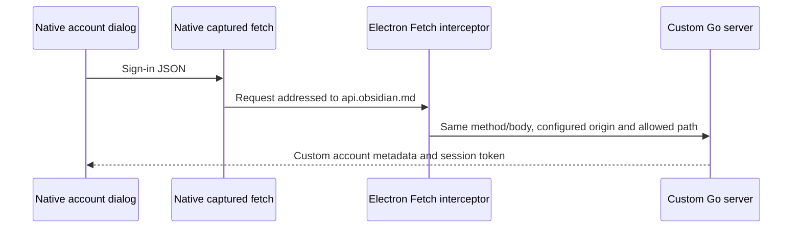
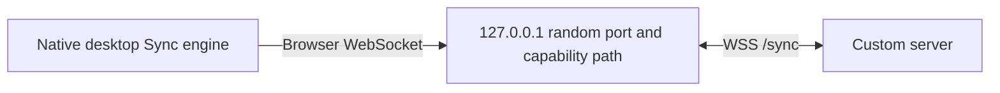
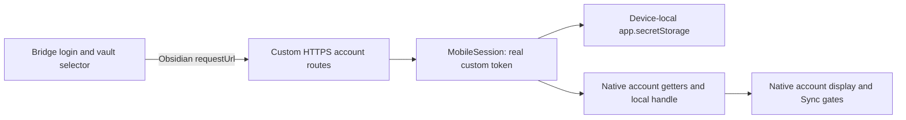
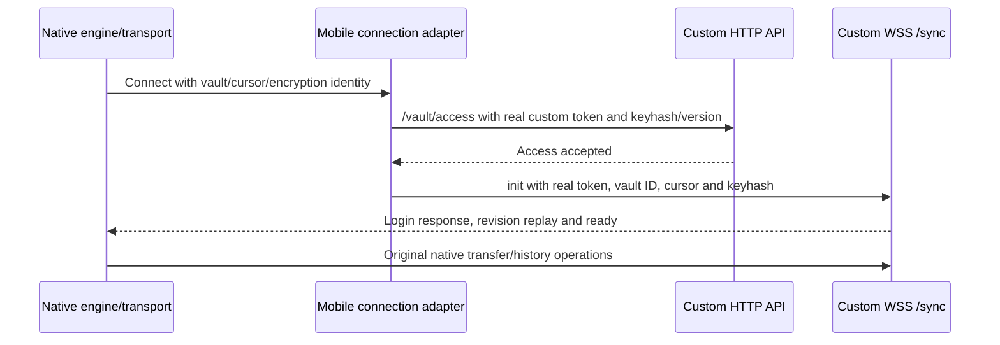

# Vault Sync Bridge 0.1.3: iPhone and desktop implementation

The development branch also offers [Mac Direct Sync](MAC-DIRECT.md) on Obsidian 1.15.1. Direct Sync is the default for fresh Mac 1.15.1 setups on the development branch. Existing routed setups and the released 0.2.0 assets use the original adapter documented below.

**Server/plugin 0.2.0 update:** the platform adapters described below are unchanged. Server 0.2.0 adds multiple users and administrator-managed co-ownership; see [migration and account operations](MULTIUSER.md). The [iOS source-harness result](ios-multiuser-0.2.0.json) verifies encrypted co-owner transfers against the new server. This is not a new on-device qualification. Use the [0.2.0 test release](https://github.com/ama156/native-vault-sync/releases/tag/0.2.0) for current assets; retain your existing bridge settings and session when updating.

This reference describes plugin **0.1.3** (`deddbd5e09796c219305efe2f1da527d993da2b6`) with server **0.1.2**. It distinguishes implementation facts, user observations and inference. Read the [mobile setup guide](MOBILE-STATUS.md), [HTTP/WebSocket API](API-REFERENCE.md), [desktop/server deep dive](TECHNICAL-DEEP-DIVE.md) and [compatibility evidence](COMPATIBILITY.md) alongside it.

## Why the native iPhone account screen now shows the custom account

**Yes: native account integration is deliberate.** After a successful custom-server login, the plugin binds that session to the actual in-memory account object used by the inspected iOS Sync implementation. Native screens that consult this object can see a signed-in state and the custom account's email/name. The owner now reports that the ordinary account screen shows this custom account and native Sync settings are accessible.

This does not register or authenticate an account with Obsidian's official service. The identity and session are issued by your private server. The account password is entered in bridge settings and sent to that server; account display fields come from its response. The bridge does not put a password into the native account display.

**This binding already existed in 0.1.2.** Comparing the release commits shows that `bindAccount()` and the direct mobile connector are unchanged in 0.1.3. The account-module change is an additional fingerprint for the native selective-sync setter. Version 0.1.3 adds attachment controls, a log button and diagnostics, rather than a new native-login patch.

The newly visible signed-in screen is consistent with an active/restored account binding after reload. The exact reason the earlier screen requested sign-in was not captured on the device; activation timing, session state or UI refresh cannot be distinguished from the available observations. We did not independently trace that earlier UI failure.

An unlocked native screen does not establish that every button it contains is supported. Use bridge settings for iPhone login, remote-vault selection and full sign-out/disable. Native controls backed by the existing Sync engine, such as file-type preferences and activity logs, can operate on the same native state. Native remote-vault management and official account/billing/licensing workflows do not become fully compatible merely because the account screen renders.

## One asset, different runtime adapters

There is one plugin ID (`vault-sync-bridge`) and one `main.js` / `manifest.json` pair. The entry point selects a platform path before loading its dependencies.

| Detail | macOS / desktop path | iPhone path |
| --- | --- | --- |
| Runtime | Electron renderer plus an owned main-process coordinator | Obsidian's mobile WebView JavaScript |
| Qualified/target client versions | Desktop 1.8.7 and 1.15.1 adapters; macOS copied-app sandbox evidence | Exact inspected iOS 1.15.1 methods; user-confirmed device flows with remaining limits |
| Account login screen | Native account dialog | Bridge-owned login screen |
| Account integration | Native account receives the custom server's ordinary account response through request interception | Per-instance native account binding backed by a plugin-owned custom session |
| Real token in native account object | Yes, through normal native account state | No; the native object exposes a local nonserializable session handle |
| Account HTTP | Native request, intercepted below captured `fetch` | Obsidian `requestUrl` to the configured server |
| Sync socket | Native socket → embedded loopback relay → custom server | Browser WebSocket directly → custom server |
| Local listener | `127.0.0.1`, random port, random capability path | None |
| Node / Electron / `ws` dependency | Loaded by the desktop adapter | Not evaluated on the mobile path |
| Attachment preferences | Native Sync settings | Bridge controls call the native setter; native settings may also display while the binding is active |
| New desktop behavior in 0.1.3 | None in routing, relay, account adapter or bootstrap | Adds selective-sync controls, log access and redacted preference diagnostics |

Windows and Linux select the desktop adapter, but this is not full-app qualification on those platforms. Android currently loads an inactive, read-only diagnostic. `isDesktopOnly:false` permits installation; it is not a claim of working Android synchronization.

## Desktop: native account requests plus an embedded relay

### Account path

The native desktop app captures its HTTP function early. Replacing global `fetch` in a later plugin does not reroute that captured reference. The investigated app also disables ordinary public `webRequest` registration. Our desktop adapter therefore attaches an owned Electron debugger session and uses the `Fetch` interception domain at request stage.

Only requests matching `https://api.obsidian.md/*` enter this interception rule. Supported `POST` / `OPTIONS` requests are continued with the configured custom origin and original pathname, preserving the body. Other matching account operations are failed with `BlockedByClient`. This is a destination rewrite in the client's request pipeline, not a server HTTP redirect or a replacement global `fetch`.

The ten account paths are `/user/signin`, `/user/info`, `/user/signout`, `/subscription/list`, `/vault/list`, `/vault/regions`, `/vault/create`, `/vault/access`, `/vault/rename` and `/vault/delete`.

The main-process coordinator covers existing and newly created web contents sharing the same Electron session, including the separate Settings window. It permits multiple same-server leases and rejects conflicting server origins. It does not steal an already attached debugger. Unexpected detachment disconnects custom Sync and reports a routing failure.

The native app owns account persistence on desktop. Its `obsidian-account` localStorage record contains the custom account metadata/token. The plugin's own settings contain the server address, enabled flag and origin binding, not the account password. This differs from the mobile device-secret-store design below.

### Sync path

The relay is bundled inside the plugin. It uses Node HTTP and `ws`, binds only to `127.0.0.1`, and creates a random 256-bit URL path for each relay instance. There is no separately installed proxy process. Upstream TLS uses normal certificate validation.

The plugin overrides the native Sync instance's `getHost()` to return this protected loopback URL while retaining the real remote host in vault metadata. Desktop 1.8.7 can use its original loopback-compatible connector. Desktop 1.15.1 rejects that destination in its original connector, so the plugin supplies an independently written connection/login bootstrap for each replacement transport instance. Post-login transfer methods and encryption remain native in both versions.

The relay forwards text/binary messages with their boundaries and binary flags. It does not translate Sync operations or decrypt note ciphertext. It limits individual messages to 2,097,152 bytes, limits concurrent socket pairs and bounds queued outbound data; an overloaded connection closes rather than growing queues indefinitely.

## iPhone: private account binding plus a direct socket

### Finding the native account instance

The supplied iOS bundle keeps its account singleton inside a private closure. Both the original file-engine loop and connection-acquisition method check that singleton's token property. The singleton is not directly exported through the SDK, and plugin code does not inherit the private closure. The account HTTP helper also captured `fetch` before the plugin loads.

The adapter uses a narrowly guarded way to obtain the receiver of that token access:

1. Verify the SHA-256 fingerprint of the native connection-acquisition method.
2. Require that `Object.prototype` has no existing own `token` property and can accept the temporary descriptor.
3. Install a temporary nonenumerable getter for that property.
4. Invoke the original method with an inert synthetic receiver, rather than the live file-engine instance. The native method accesses its closed-over account's missing token; the getter captures the account receiver and returns `undefined`.
5. The method exits at its account-presence gate without constructing a transport. Remove the temporary descriptor in `finally`, before awaiting the returned promise. There is no event-loop turn while the getter is installed.
6. Require the exact expected empty account shape and account-class fingerprint. Existing accounts and saved signed-out accounts are refused unchanged.

This is runtime reflection of the installed client. The distributed plugin contains fingerprints and independently written adapter code, not copied proprietary account/file-engine implementations. A runtime or source mismatch fails activation.

### Binding a verified custom session

After custom login, `bindAccount()` installs properties and methods on that specific account instance. Original descriptors are recorded for cleanup.

| Native account member | Bridge behavior on iPhone |
| --- | --- |
| `token` | Returns a local handle while the session holds a token; otherwise an empty string |
| `email`, `name` | Read current custom-server account metadata |
| `license`, `key` | Do not supply an official license/key; the session's license is empty and key getter returns null |
| `getUserInfo()` | Refresh the custom account through `/user/info` |
| `logout()` | Sign out/revoke the custom session |
| `save()` | No-op, keeping the bridge session out of native account storage |
| Native login/auth-token/license setters | Blocked; use bridge setup |

The local handle is a truthy object, sufficient for native account-presence checks. It is **not the bearer token sent to the server**. Its JSON conversion, string conversion and primitive conversion throw. When a legacy native helper tries to serialize that handle as an account token, serialization fails before its captured HTTP function is invoked. The original native file engine remains unchanged; it sees a session presence only after verified custom login or session restoration.

This explains the native UI: its account and Sync gates can observe the same in-memory signed-in state, and its account display can read custom metadata. The bridge does not paint a fake account page or change the on-disk application bundle.

There is no general iOS network interceptor equivalent to the desktop one. The serialization guard protects native token-bearing helper calls; the plugin also overrides the specific account methods listed above. This does not redirect every possible native account action, website link or unrelated app request. Use bridge screens for supported account operations rather than assuming the complete official account UI is now a custom-server administration UI.

### Real HTTP session and token persistence

`MobileSession` constructs requests from the configured server origin and an explicit route allowlist: `/user/signin`, `/user/info`, `/user/signout`, `/vault/list` and `/vault/access`. Passwords are used for the relevant login/unlock call and are not persisted by the bridge.

The real bearer token is held in a private session field and stored through Obsidian's device-local secret API. The secret identifier is derived from SHA-256 of server origin plus app/vault identity; the saved record also includes and validates the server origin. Activation requires the secret-storage API to report encryption available. This is use of the app's storage facility, not an independent audit of the phone's hardware/keychain implementation.

The plugin's ordinary vault `data.json` stores nested `iosTest` server/enabled/vault-binding settings, not this token. It does not inherit the desktop's activation flags. The adapter does not persist the real custom token or the local handle into `obsidian-account`. The optional initial-setup empty-record preparation is a separate explicit action and is not part of normal login/update.

Login and restored sessions are checked against the custom server. While active, foreground/focus events and a foreground refresh timer refresh authorization. Expiry/revocation detected through HTTP or socket errors clears the custom session, closes the account-presence gate and pauses/disconnects custom Sync. A displayed local signed-in state is not a replacement for server authorization on each operation.

### Direct native transport bootstrap

The adapter watches the native instance's replaceable `server` property and adapts each transport's `connect()` method. It verifies the transport-class fingerprint, preflights the vault's authorization/encryption identity, then opens browser `WebSocket` directly to `wss://SERVER/sync`. It does not use Electron, Node HTTP, Node filesystem APIs, a loopback listener or `ws` on iPhone.

Unlike the desktop adapter, it does not replace `getHost()` with a local URL. Vault metadata retains the custom remote host; the adapted connector constructs the actual socket URL from the bound session origin. The connector substitutes the real custom token for the local handle at WebSocket login.

It sets binary type, login timeout and heartbeat, validates the login response, and forwards subsequent messages to the original native handlers. The server accepts the observed exact iOS Origin `capacitor://localhost`; authorization, vault keyhash and encryption-version checks still apply. No wildcard Android origin workaround is used.

## Shared native engine and server responsibilities

Both adapters leave file watching/indexing, native filters, encryption/password derivation, transfer decisions, revision handling, downloads, history and conflict resolution in Obsidian. The bridge's mobile password field passes the vault password to native setup; the derived key remains native state. Native Sync persists its own key/index state locally, so “the bridge does not save the vault password” must not be read as “the app stores no encryption material.”

The Go server authenticates its own account/session, validates vault permission and encryption identity, orders revisions, and stores ciphertext plus revision metadata. It does not merge plaintext notes or receive the vault encryption password/raw key. Vault display names, extensions, sizes, timestamps and device/revision metadata are separate from encrypted note contents and paths. See the API reference for the exact disclosure and wire contracts.

The native transport operations remain `init`, `push`, `pull`, `history`, `deleted`, `restore`, `size`, `usernames` and `ping`/`pong`. Binary pieces are bounded at 2,097,152 bytes; larger attachments use multiple pieces. Server version 0.1.2 and its database format did not change for plugin 0.1.3.

## Attachment controls refer to the same native preferences

The iPhone controls call the exact fingerprinted native `setSyncType(category, enabled)` and persist native state. They are an alternate way to operate the same filter, not a separate upload implementation. The native setter requeues previously ignored remote files and requests synchronization. It does not reset the revision cursor, remote connection or folder exclusions.

| Files | Native category |
| --- | --- |
| PNG/JPG/SVG/WebP and the inspected supported image extensions | `image` |
| PDF | `pdf` |
| Native supported audio / video extensions | `audio` / `video` |
| ZIP, EPUB, HEIC and other uncategorized extensions in the inspected iOS build | `unsupported` (“Sync all other types”) |

These preferences apply on each device. Receiving a note containing a link does not prove the linked binary file was selected for upload/download. Enable the relevant category on both ends and account for excluded folders.

The owner recovered PNG/PDF after enabling Mac all-other-types and restarting iPhone Obsidian together. That combined observation does not establish a single root cause, nor does it reclassify PNG/PDF as other types. The improved isolated harness uses the original native category filter; the earlier attachment proof used a simplified filter and did not cover all selection behavior. The [attachment regression](ios-attachment-regression.json) documents the expanded tests.

## Disable, sign-out and update behavior

| Action | Desktop | iPhone |
| --- | --- | --- |
| Unload/disable | Disconnect socket, close relay, release owned routing hooks, restore host/bootstrap methods | Pause owned custom connection, disconnect socket, restore owned account/transport descriptors, clear in-memory session |
| Persistent account token after unload | Native account state remains app-managed | Device secret retained for later bridge resumption; it is not left in native account storage |
| Full custom sign-out | Use native account sign-out while routing is active | Prefer bridge “Sign out / disable” to revoke and finish full cleanup |
| Notes/index | Remain native local data | Remain native local data |
| Server change | Existing account/origin binding and remote vault safeguards apply | Refused while the custom session is attached; sign out first |

Desktop routing must be active when native custom-account operations run. Removing routing restores the native request destination; use native sign-out while routing is active before intentionally retiring the custom account/routing setup. Opening Developer Tools can detach the desktop interceptor, which the plugin detects and reports. None of these debugger constraints apply to the direct iPhone adapter.

For an ordinary 0.1.2→0.1.3 plugin update, retain settings/session/vault state and reopen the app. Do not disconnect the remote vault or use initial-setup reset/preparation steps just to update. Continuous iOS background execution is not promised; foreground/reconnect replay is the supported initial lifecycle target.

## Source map and evidence limits

All links below point to this repository's independent implementation, not redistributed proprietary client code.

| Source | Responsibility |
| --- | --- |
| [entry.cjs](../plugin/src/entry.cjs), [compatibility.cjs](../plugin/src/compatibility.cjs) | Platform selection and version gates |
| [main.cjs](../plugin/src/main.cjs) | Desktop settings, activation, host override and cleanup |
| [main-coordinator.cjs](../plugin/src/main-coordinator.cjs), [account-router.cjs](../plugin/src/account-router.cjs) | Desktop shared-session interception |
| [relay.cjs](../plugin/src/relay.cjs), [connection-bootstrap.cjs](../plugin/src/connection-bootstrap.cjs) | Desktop local relay and newer-client bootstrap |
| [ios-account.cjs](../plugin/src/ios-account.cjs) | Native account capture, local handle and reversible binding |
| [mobile-session.cjs](../plugin/src/mobile-session.cjs) | Custom account HTTP/session/secret storage |
| [ios-controller.cjs](../plugin/src/ios-controller.cjs), [ios-main.cjs](../plugin/src/ios-main.cjs) | Mobile setup, session lifecycle and UI |
| [ios-connection.cjs](../plugin/src/ios-connection.cjs) | Direct mobile WebSocket bootstrap and replacement tracking |
| [native-file-types.cjs](../plugin/src/native-file-types.cjs), [mobile-report.cjs](../plugin/src/mobile-report.cjs) | Category UI definitions and redacted diagnostics |
| [server implementation](../server/internal/syncserver) | Authorization, protocol, SQLite and ciphertext storage |

The code comparison for desktop behavior used `cbe7ddf` (0.1.2) versus `deddbd5` (0.1.3). Desktop `main`, coordinator, router, relay, bootstrap, entry point, address validation and compatibility modules are identical between those commits. `bindAccount()` and the direct iOS connector are also unchanged. One asset does not imply the adapters are identical internally.

The 0.1.3 suite passed 27 plugin tests and twelve isolated native-source/real-server checks; Linux CI passed. The owner reports real-phone note sync/recovery, recovered PNG/PDF transfer, and now native account-display/Sync-settings access. This is user-reported evidence rather than independently captured device instrumentation. It does not certify every native account action, all attachment size/direction combinations, background operation, arbitrary app versions or Android support. The [device record](ios-device-tests.json) retains the correction history. Automated work used disposable resources and did not launch or modify `/Applications/Obsidian.app` or the owner's main Mac profile.
