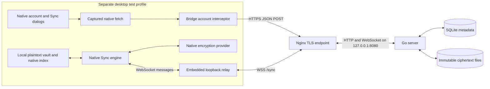

# Native Vault Sync: technical deep dive

This document explains the reverse-engineered desktop client contract and the independent **Vault Sync Bridge/server 0.1.0** implementation. The implementation baseline is commit [`5159ae5`](https://github.com/ama156/native-vault-sync/tree/5159ae5f90cd88e2d9aa89c5a4edd7bd88594a8c). Documentation was expanded on 17 November 2026. It does not describe recovered official server source; that source was never available.

Read alongside the [API reference](API-REFERENCE.md), [OpenAPI document](HTTP-API.openapi.json), [concise protocol contract](PROTOCOL.md), and [compatibility evidence](COMPATIBILITY.md). The OpenAPI document covers HTTP; WebSocket message sequencing is specified in the API reference.

## 1. Evidence and scope

The labels used below distinguish three things:

- **Observed client:** behavior read from a fingerprinted client bundle, with selected transport/encryption functions executed by the development harness.
- **Our implementation:** a deliberate server/plugin design choice. It is not evidence of how the official backend is implemented.
- **Tested:** behavior exercised by the recorded integration tests, within their stated runtime and platform limits.

| Evidence | Scope |
| --- | --- |
| Desktop 1.8.7 `app.js` | SHA-256 `fc1b1bede214e0f28266ce356b43c2aa36329a3b3cb47160f3a086110a03c9b5` |
| Desktop 1.15.1 `app.js` | SHA-256 `31c39502ad7ca49b003ea3fb2fef5889b00160c0290e548e3cc5c6506b8c4d31` |
| [Initial feasibility](feasibility.json) | Two full 1.8.7 copied app bundles through the plugin against the research fixture |
| [Native contracts](native-contracts-1.8.7.json) | 18 real-socket transport/encryption checks against the Go server, across versions 0, 2, 3 |
| [Full application cases](full-app.json) | Cross-version synchronization, settings, rename/delete/restore, large files, restart, plugin reload, and one simultaneous offline-merge scenario |
| [Go checks](server-tests.json) | Nine integration cases with the race detector; static analysis |
| [Crash/recovery](crash-recovery.json) | Separate server processes, SIGKILL, partial uploads, persistent sessions, fresh-install backup restore |

Full-app tests used unmodified copied/downloaded app archives in a **separate Electron 43.1.1 macOS runtime**, disposable profiles, and synthetic vaults. That qualifies the exercised app bundles and adapters, not every original standalone installer, OS, Electron version, or conflict case. Linux amd64 CI passed the server/plugin checks and both Linux cross-builds. Cross-compilation does not establish arm64 execution.

The original research notes proposed several possible routing techniques and described a provisional Node backend. Those proposals are historical evidence, not instructions for this implementation. In particular, this server does **not** pin encryption identity on the first connection, use a fixed research salt, or store everything by rewriting a JSON snapshot.

## 2. Architecture: two connections and three responsibilities

There are two independent network paths:

1. **Account API:** JSON POSTs for authentication, account metadata, capability discovery, and remote-vault management.
2. **Sync transport:** a long-lived WebSocket carrying encrypted identifiers, revision metadata, and binary ciphertext.

Changing only the WebSocket destination is insufficient: the client still needs an account session, a remote vault ID, a salt, an encryption version, a matching key identity, and valid host metadata.



| Component | Owns |
| --- | --- |
| Native app | Watching files, local indexes, filters, scheduling, password/key derivation, encryption/decryption, upload decisions, applying downloads, conflicts and merges |
| Bridge plugin | Account-request destination routing, an embedded WebSocket relay, runtime connection adaptation, version checks and cleanup |
| Go server | Custom account/session authorization, vault metadata, ordered revisions, ciphertext storage, replay, history, quotas and administration |

The bridge does not translate the Sync protocol, decrypt file traffic, or replace the file engine. In 1.15.1 it also supplies an independent connection/login bootstrap because that build rejects loopback in its original connector. All subsequent transfer methods and message processing remain native.

## 3. What the client needs access to

### Network access

| Initiator | Destination | Purpose |
| --- | --- | --- |
| Plugin connection test | `https://YOUR-SERVER/healthz` | Verify service identity, bridge protocol and readiness |
| Native account requests, while intercepted | `https://YOUR-SERVER` plus allowlisted account paths | Sign in, refresh account, list/create/access/manage vaults |
| Native Sync connector | `ws://127.0.0.1:EPHEMERAL-PORT/RANDOM-CAPABILITY` | Connect to this plugin launch's embedded relay |
| Relay | `wss://YOUR-SERVER/sync` | Forward native text/binary WebSocket messages |
| Nginx | `http://127.0.0.1:8080` on the Linux host | Reach the private Go listener |

The desktop needs outbound HTTPS/WSS to your domain. The server's port 8080 does not need public exposure. The desktop relay binds only to IPv4 loopback and chooses its own port. Certificate validation remains enabled on the upstream connection. Ordinary production HTTP origins are rejected; an explicit `http://127.0.0.1` origin is allowed for development.

Native account code still asks for `https://api.obsidian.md/...`; the bridge changes the destination below that captured function. This does not require DNS overrides, modifying the hosts file, installing a custom certificate authority, or repacking the app.

The adapter is not a firewall for the entire app. Native updater, plugin-catalog and other unrelated requests are outside its allowlist. Startup captures in the tested custom profile showed only owned loopback Sync destinations and no official account API requests; the native community-plugin deprecation-list request remained unrelated app traffic. These observations do not promise network isolation before plugin activation, after disabling it, or on unqualified versions.

### Client state and credentials

| Item | Used by | Sent to custom server? |
| --- | --- | --- |
| Custom account email/password | Native account dialog and HTTP helper | Yes, at sign-in, protected in transit by HTTPS |
| Custom session token | Native account helper and Sync login | Yes; bearer credential in JSON, not an Authorization header |
| Vault ID, name, host, salt, encryption version | Native remote-vault setup | Yes; discovery/access metadata |
| Vault encryption password | Native key derivation | No |
| Raw vault key/provider | Native encryption and local state | No |
| `keyhash` | Native access check and WebSocket init | Yes; version-specific encryption-identity verifier |
| Plaintext paths and note bytes | Local native engine | Not in native encrypted Sync traffic |
| Opaque encoded paths/hashes and ciphertext | Native transport | Yes |
| Extensions, times, sizes, rename relationships and device label | Native transport | Yes |

The account password and vault password have different purposes. Losing the vault password/key is not repaired by resetting the server account password. Conversely, knowing a vault keyhash must not authorize someone to access a vault: the server requires an authorized account session as well.

### Plugin privileges and private API access

The bridge uses these facilities:

- Normal Obsidian `Plugin`, settings, notices, configuration persistence and app version APIs.
- The native Sync instance obtained through `app.internalPlugins.getPluginById('sync').instance`.
- Runtime access to `getHost`, `server`, `requestSync`, transport methods and the encryption-provider identity fields needed for the 1.15.1 login bootstrap.
- Electron window/webContents access and the debugger `Fetch` domain for account interception.
- `window.electron.remote.require` to load **its own installed bundled `main.js`** into the main process, where it coordinates windows sharing a session.
- Node HTTP, cryptographic randomness, timers and the bundled `ws` package for the relay.

This is a trusted desktop community plugin running with the app's privileges. Its design does not require note plaintext or vault passwords, but it is not cryptographically prevented from accessing app memory/files. Electron debugging and main-process access are powerful capabilities. End-to-end encryption protects the network/server boundary, not a compromised local app/plugin.

The loopback capability is a random 256-bit path, regenerated for each relay instance. It prevents an arbitrary website or blind local connection from simply guessing the relay URL. It is not a defense against another process with access to the user's memory or profile. Account tokens still appear inside the native local WebSocket's init message; keep the local machine trusted.

## 4. Reverse-engineered client layers

### Account helper

**Observed client:** the 1.8.7 bundle captures `window.fetch` during initialization, constructs an account API base at `https://api.obsidian.md`, POSTs JSON, and treats an `error` member as an application error. Reassigning `window.fetch` from a later-loaded plugin leaves that captured reference unchanged.

The native account state uses the `obsidian-account` localStorage entry. The observed returned fields include `token`, `email`, `name`, and `license`. These are app-managed account state, not bridge settings.

The newer inspected helper checks the HTTP success status before consuming the JSON application error. Our server therefore returns semantic account failures as HTTP 200 with `{"error":"..."}`. Malformed JSON, invalid origins, rate limits, and unsupported routes can still produce non-2xx HTTP errors. See the API reference for details.

### Native transport

**Observed client, 1.8.7:** the transport captures WebSocket and URL helpers too. It permits a hostname ending in `.obsidian.md` or exactly equal to `127.0.0.1`. `localhost` passes one scheme-selection branch in the engine but fails the later transport guard. An arbitrary custom `wss://` hostname fails before a socket is constructed.

The engine's `getHost()` has a loopback fallback, but an unconfigured vault still lacks required account, host, vault ID and encryption-provider state. The fallback is not a working self-hosting setting.

The native transport serializes ordinary requests and separately handles `op: push`, `op: ready`, and `op: pong`. It has no per-request IDs. An unsolicited push can arrive while an upload awaits acknowledgment; a client must dispatch notifications separately rather than interpreting the next JSON message as the response.

The old transport's binary waiters rely on browser WebSocket task scheduling. The Node development harness deliberately dispatches each received message as a separate browser-like task. Without that adapter, Node `ws` can emit several messages synchronously before the old code installs its next binary waiter. That harness accommodation is not a change to the shipping plugin or native file engine.

### Native file engine and index

**Observed client, 1.8.7:** the engine persists an IndexedDB Sync index associated with the app/vault identity. Its state includes local and server file records, newly received remote records, the revision cursor, the `initial` flag, host, device, encryption settings and filters. Account state and Sync index state are separate.

The native engine decides what to transfer. Markdown and Canvas receive built-in handling; other file types use configured filters. Selected configuration files are scanned separately. Workspace files and ordinary hidden paths have exclusion rules. Do not recreate those rules in the server by guessing from file extensions or opaque paths.

Inspected 1.8.7 scheduling includes these delays for a file that already has a sync timestamp:

| File size | Eligible when elapsed time is strictly greater than |
| --- | --- |
| Up to 10,240 bytes | 10 seconds |
| More than 10,240, up to 102,400 bytes | 20 seconds |
| More than 102,400 bytes | 30 seconds |

A file without a previous sync timestamp is immediately eligible under that rule. Failed-file retry delay increments the retry count, then uses `min(5000 * 2^count, 300000)` milliseconds; the first counted retry is 10 seconds. Reconnect/backoff and scheduling mean a ready/synced indicator is not a substitute for checking the final file after an outage.

Markdown conflict merging happens in the client using local/remote/base text and diff/patch logic. Configuration JSON has separate merge behavior, including core-plugin-list repair. Our full-app test preserved both edits to distinct paragraphs after both clients edited offline. That is one tested merge scenario, not a specification of every conflict strategy. The server only retains and orders encrypted revisions.

### Version-specific source anchors

These are **zero-based UTF-16 source positions** in the fingerprinted 1.8.7 `app.js`, not native addresses or positions valid for 1.15.1. Minified names can change between builds.

| Role | Recovered symbol | Function entry |
| --- | --- | ---: |
| Account JSON helper | `_W` | 1,979,242 |
| Vault listing helper | `ej` | 1,982,130 |
| Vault access helper | `oj` | 1,982,931 |
| Native setup | `a0.setup` | 2,874,680 |
| Sync state persistence | `a0.saveData` | 2,873,802 |
| Host selection | `a0.getHost` | 2,881,686 |
| File engine loop | `a0._sync` | 2,885,322 |
| Socket login/host guard | `s0.connect` | 2,903,716 |
| Download | `s0.pull` | 2,905,959 |
| Upload | `s0.push` | 2,906,725 |
| Serialized request | `s0.request` | 2,911,171 |
| Message dispatch | `s0.onMessage` | 2,911,672 |
| Password derivation | `OW` | 1,974,552 |
| Encryption provider selection | `BW` | 1,975,051 |

These anchors summarize the supplied investigation and were cross-checked against the sandbox copy. No proprietary function bodies are distributed with this reference.

## 5. Why the bridge uses these routing hooks

### HTTP interception below captured fetch

The full application replaces public Electron `webRequest` registration functions with no-ops. An ordinary plugin registration can appear to succeed while never receiving requests. The initial full-app feasibility work found this directly.

Our adapter attaches an owned Electron debugger session and enables the `Fetch` domain with a request-stage pattern for `https://api.obsidian.md/*`. For supported POST/OPTIONS requests it calls `Fetch.continueRequest` with the new origin and original pathname. It preserves the method and JSON body. Unsupported account operations are failed with `BlockedByClient` while custom routing is active. Original app request/response protections are left installed.

This is request interception in the browser's network path, not an HTTP redirect returned by the server. A server-side redirect alone would not solve the captured fetch, CORS, method/body, or native host-guard problems.

### Session-wide coordination

The 1.15.1 app can create a separate Settings window. Hooking only the vault renderer leaves those account requests uncovered.

The bundled main-process coordinator owns one router per matching-session webContents. Leases identify active bridge windows. Acquisition/release is serialized, new webContents are observed, same-server windows share the routing configuration, and conflicting origins in one Electron session are rejected. Releasing the last lease removes the owned debugger hooks and window-creation listener.

An already-attached external debugger is not stolen. Unexpected debugger detachment marks routing inactive, disconnects the native connection and instructs the user to close Developer Tools and reactivate. This is a reported failure, not an independent firewall that can prevent every future native account request.

### Embedded relay and runtime overrides

The relay runs inside the plugin process, listens on `127.0.0.1:0`, and accepts only the random capability path. It first opens its upstream WSS connection, then completes the local upgrade. It preserves text/binary message types, boundaries, ordering and closure. There is no JSON parsing or protocol translation in the relay.

The native vault keeps the real remote `host` metadata, such as `sync.example.com/sync`. Only the in-memory `getHost()` method returns the protected loopback URL. This keeps an ephemeral port/capability out of persisted remote metadata.

- **1.8.7:** original native connect logic accepts the loopback relay.
- **1.15.1:** the original connector no longer has the loopback exception. The plugin temporarily wraps the native `server` property and replaces new transports' `connect` method with an independently written WebSocket/login/heartbeat bootstrap. After an accepted login it hands messages to native `onMessage` and restores native disconnect/error handling. Native crypto, pull/push, indexing and merge methods remain in use.

On unload, the plugin disconnects its native connection, restores its owned method/property changes, releases routing and closes the relay. It does not delete local notes or native Sync state. The original connector/account behavior can resume after removal, so disabling the bridge should not be treated as a private-server isolation mode.

One custom-server account per app profile is supported. Account routing affects windows sharing the Electron session, even though plugin installation/settings are vault-local. Use a genuinely separate profile/runtime for testing alongside an official account; another vault in the same profile is not account isolation.

## 6. Encryption boundaries and version behavior

Detailed cryptographic observations in this section refer to the inspected **1.8.7 provider code**. Cross-version encryption-3 transfer was tested, but this document is not an independent complete crypto reimplementation specification for every current client.

### Key derivation and provider selection

The client normalizes the vault password and salt using NFKC before scrypt:

```text
key = scrypt(UTF8(NFKC(password)), UTF8(NFKC(salt)),
             N=32768, r=8, p=1, output=32 bytes)
```

The Node branch sets a 67,108,864-byte memory ceiling. Provider dispatch accepts versions **0, 2, 3**; version 1 is not a supported branch in this inspected client or our server.

The older bundle's default creation version is 0 unless the `sync-use-encryption-v3` localStorage flag enables 3. The tested 1.15.1 native creation flow selected version 3 by default. The bridge preserves the selected version and never rewrites 0/2 into 3.

| Operation | Version 0 | Versions 2/3 in the inspected provider |
| --- | --- | --- |
| `keyhash` | Hex SHA-256 of the 32-byte key | Hex exported HKDF/SHA-256-derived 32-byte material using the vault salt and `ObsidianKeyHash` label |
| Path/hash identifiers | Deterministic AES-GCM; IV is first 12 bytes of SHA-256 of UTF-8 identifier text | Deterministic AES-SIV using separately derived material |
| Nonempty file content | AES-GCM using the provider key | AES-GCM with material derived using `ObsidianAesGcm` and empty HKDF salt |
| Wire encoding of identifiers | Hex | Hex |

The SIV implementation derives separate encryption/MAC material with `ObsidianAesSivEnc` and `ObsidianAesSivMac` labels. Sharing a provider class in 1.8.7 is not a reason to discard the advertised version field or assume every future format is interchangeable. Version 0's deterministic scheme is recorded for interoperability, not recommended as a new encryption design.

The inspected 1.8.7 local key serialization uses base64, while wire identifiers/keyhash use hex. Neither encoding is encryption. This is another reason to keep local profiles and development captures private; it is not a claim that every later client persists keys in the same format.

For file contents, the observed wire layout is a random 12-byte IV followed by the WebCrypto AES-GCM ciphertext and 16-byte authentication tag. Nonempty ciphertext is therefore plaintext length plus **28 bytes**. Empty files skip encryption and have zero wire bytes/pieces. Binary data is sent as binary WebSocket messages, not base64 inside JSON.

### Three different hashes/identifiers

| Name | Meaning | Who interprets it? |
| --- | --- | --- |
| `keyhash` | Version-specific verifier identifying vault encryption material | Native client and server equality check |
| Revision `hash` | Native deterministic encoding of the client's content-hash identifier | Native engine; server preserves it as opaque text |
| Blob filename/hash | Our server's SHA-256 of the **ciphertext bytes** | Our storage implementation only |

They are not interchangeable. The server's blob checksum does not reveal or validate the native plaintext content hash. The server cannot validate a GCM authentication tag without the key; the native recipient detects tampering/decryption failure.

Deterministic identifiers reveal equality and relationships even when names are encrypted. The server also sees account and remote-vault names, salt/keyhash, file extensions, sizes, timestamps, devices, tombstones and revision/rename relationships. TLS terminates at Nginx, which can observe account requests and encrypted Sync payloads; file end-to-end encryption remains between native clients.

## 7. Server data model and consistency

**Our implementation:** a single process owns one SQLite metadata database and local immutable ciphertext files. This is not a reconstruction of the official backend's database or deployment topology.

```text
/etc/vault-sync/config.json
/var/lib/vault-sync/
  server.lock
  metadata.sqlite
  metadata.sqlite-wal       # while SQLite requires it
  metadata.sqlite-shm
  uploads/upload-...        # incomplete private uploads
  blobs/<vault-id>/<sha256-of-ciphertext>
```

| Table | Purpose |
| --- | --- |
| `owner` | One account, display name and salted password hash |
| `sessions` | SHA-256 token hashes, creation and expiry times |
| `vaults` | Salt, keyhash, encryption version, latest per-vault cursor, soft-delete flag |
| `revisions` | Immutable per-vault UID stream and opaque path/hash metadata; blob reference |
| `blobs` | Retained unique ciphertext files per vault and their sizes |

Revision IDs are **per vault**, not globally unique. Every committed update, folder operation, tombstone and restore consumes a new UID. `version` in init/ready is a cursor into this stream, not an app version or encryption version. JSON-safe integer range is enforced.

### Durable upload sequence

1. Validate session/vault and metadata; reserve quota for the declared complete ciphertext size.
2. Stream each acknowledged piece to an upload file. The server buffers a piece, not the entire file.
3. After the last piece, synchronize the complete file, compute ciphertext SHA-256, close it, install the immutable blob and synchronize its directory.
4. In one SQLite transaction, recheck session authorization, allocate the next vault UID, insert revision/blob references, and advance the vault cursor.
5. Commit with SQLite WAL/full synchronization.
6. Enqueue the committed push notification and final success acknowledgment.

Intermediate piece acknowledgments mean that piece was accepted into the pending upload; they are not durable revision commits. Only the final acknowledgment follows full blob installation and database commit.

A disconnect or crash during an incomplete upload leaves no visible revision. On startup, abandoned upload files are removed. A crash between blob installation and database commit may leave an orphan blob; recovery removes it. Missing referenced blobs or size/type mismatches prevent successful startup. Normal startup checks existence/type/size, not every ciphertext SHA-256; backup restoration additionally verifies checksums and SQLite integrity.

There is still a commit/ack ambiguity if the database commits and the connection dies before the client sees success. A retry can create another revision; there is no idempotency-key or exactly-once API. History and opaque-hash reuse preserve content, but consumers should not infer exactly-once delivery from TCP/WebSocket.

### Replay and live ordering

At initialization the server holds its store mutex across snapshot/cursor selection, replay enqueueing, the `ready` watermark, and registration for live updates. Commits use the same mutex, so a concurrent revision falls either into replay or into the later live stream without a gap at that handoff.

`initial: true` sends the latest record per path, excluding latest tombstones. `initial: false` replays every revision with UID greater than the supplied cursor, including tombstones. It then sends `ready` with the matching end cursor. A ready message is a replay boundary; applying the queued content still belongs to the native engine.

Each connection has one outbound writer. A pull response's metadata and all of its binary messages are one writer job. Notifications wait until that job ends, so they cannot corrupt binary download reconstruction. Notifications can otherwise precede ordinary acknowledgments and must be dispatched by `op`.

### History, restore, rename and retention

Old revision bytes are immutable. Restore creates a new revision referencing the selected historical blob, updates modification time and records the restoring device. The selected original revision remains available.

File deletion creates a tombstone. Rename/move relationships are carried in opaque `relatedpath`; the server preserves native operations rather than rewriting a directory tree or interpreting plaintext paths. The deleted-file listing can suppress rename tombstones. Folder operations are metadata-only revisions.

Remote-vault deletion is a **soft deletion** in 0.1.0. It removes discovery/access and disconnects clients, but keeps historical ciphertext and retained-storage accounting. `purge`, permanent reclamation and automatic history pruning are unsupported. Restoring an older server backup can put a client's cursor ahead of the server; that is rejected, requiring native remote-vault reconnection rather than silently skipping changes.

### Quotas and scalability boundaries

- Account storage is the sum of retained unique ciphertext blobs, including history and soft-deleted vaults. It excludes filesystem/SQLite overhead, so the configured limit is not a complete disk-space reservation.
- `vault_size` and vault-list `size` describe the latest nondeleted file revisions' logical ciphertext sizes. They differ from retained account usage.
- An upload reserves its declared size against stored bytes plus other reservations before binary transfer. Exact ciphertext blob reuse is accounted once per vault.
- Same path/opaque hash/size can reuse a historical blob without an upload. This optimization trusts native client metadata; it is not server-side plaintext verification.
- SQLite uses one connection; a global store mutex serializes commits and replay handoffs. Independent vaults still contend for this single-process writer.
- Replay/deleted queries materialize result arrays. Output queues are bounded, but total revision metadata and some list responses are not constant-memory. This is a personal server, not a proven large multi-tenant service.
- The relay limits each complete WebSocket message, text or binary, to 2 MiB. An unusually large history/deleted-list response can exceed that guard; list operations are not an unbounded streaming API.
- Exclusive local file locking rejects a second serving process against the same data directory. Do not scale it by starting several writers or putting its SQLite directory on a distributed/network filesystem.

## 8. Authentication, limits and failure behavior

Account passwords use Argon2id with a random 16-byte salt, 64 MiB memory, three iterations, parallelism two and a 32-byte output. The password format stores salt/hash; only the current hardcoded parameters are supported by this release. Account password length is 12–1024 UTF-8 bytes.

Issued tokens are `vs1_` plus 32 random bytes encoded as 64 hex characters. Only their SHA-256 hashes are stored. Sessions survive service restart and expire 90 days after issuance. There is no refresh-token endpoint. Native signout revokes that session; CLI password reset revokes all sessions atomically.

Authorization is rechecked on incoming authenticated frames and inside revision commit. Broadcasts skip/cancel revoked sessions. An in-progress download writer is not a per-byte revocation barrier: an already-enqueued transfer can finish before the next check. Idle sessions are not guaranteed to close immediately at the instant of CLI revocation.

| Implementation bound | Value |
| --- | --- |
| Open Sync connections | 64 total, including unauthenticated connections |
| Init deadline | 10 seconds |
| Authenticated read deadline | 130 seconds; 60 seconds awaiting an upload piece |
| HTTP JSON / inbound WebSocket metadata | 65,536 bytes |
| Binary message size | 2,097,152 bytes |
| Outbound writer jobs | 64 per connection; ordinary queue overflow disconnects |
| Replay enqueue timeout | 45 seconds per enqueue |
| Socket write timeout | 60 seconds per text/binary message |
| Login work | Two concurrent Argon2 verifications; ten attempts/minute globally |
| Relay pairs | Eight per plugin relay |
| Relay queued-byte guard | 16 MiB of target buffered bytes including the next message |
| Upstream relay handshake timeout | 15 seconds |
| Native ordinary request timeout, inspected 1.8.7 | 60 seconds |
| Native heartbeat, inspected 1.8.7 / new bootstrap | Every 20 seconds; ping after more than 10 seconds silence, disconnect after more than 120 seconds |

Some limits are hardcoded; vault/storage/file limits are configuration fields. An authenticated vault can retain arbitrarily many metadata-only revisions over time: ciphertext quota does not bound total revision count. The full ready health check only verifies the account query at request time; it is not a live disk-capacity or end-to-end synchronization test.

Error strings can affect native account/vault state. `Not logged in` denotes a genuinely invalid/expired/revoked session. Transient database failures use a distinct temporary-unavailability error so the native client is not falsely told to clear an account or abandon a vault. Clients should follow native error/retry behavior and check server logs for underlying operation failures.

## 9. Administration and backup trust boundaries

There is no web administration UI or public administrative REST API. Account creation, password reset, session inspection/revocation and backups are local CLI operations. systemd runs the binary as an unprivileged `vault-sync` user. Nginx terminates HTTPS and forwards HTTP/WebSocket traffic to the private listener with a 300-second read timeout.

Backups require the service to be stopped and acquire the same exclusive data lock. `VACUUM INTO` produces a consistent SQLite snapshot; the archive includes configuration and ciphertext. Restore requires a new configuration filename and nonexistent data directory, rejects unsafe/nonregular archive entries, checks database integrity and ciphertext checksums, and installs into the new destination.

A backup contains account password hashes, session-token hashes, keyhashes, account/vault metadata and ciphertext. It excludes local native vault keys and plaintext notes. Protect it as a credential-bearing server snapshot; encryption does not make all backup metadata public. Restoring the session table can preserve sessions known to existing clients until their saved expirations.

## 10. Code navigation and change discipline

| Concern | Independent source |
| --- | --- |
| HTTP contracts, origins and account errors | [`http.go`](../server/internal/syncserver/http.go) |
| WebSocket init, framing, writer, operations and broadcast | [`websocket.go`](../server/internal/syncserver/websocket.go) |
| Schema, passwords/sessions, revisions and blob installation | [`store.go`](../server/internal/syncserver/store.go) |
| Startup and checksum validation | [`integrity.go`](../server/internal/syncserver/integrity.go) |
| Offline archive and restore | [`backup.go`](../server/internal/syncserver/backup.go) |
| Local commands and HTTP runtime | [`main.go`](../server/cmd/vault-sync-server/main.go) |
| Activation, account binding and method cleanup | [`main.cjs`](../plugin/src/main.cjs) |
| Account interception | [`account-router.cjs`](../plugin/src/account-router.cjs) |
| Session/window coordination | [`main-coordinator.cjs`](../plugin/src/main-coordinator.cjs) |
| Current-client connection bootstrap | [`connection-bootstrap.cjs`](../plugin/src/connection-bootstrap.cjs) |
| Capability relay and backpressure guard | [`relay.cjs`](../plugin/src/relay.cjs) |

For a new desktop build, inspect its fingerprinted sandbox source first, verify private method/property shapes, establish account/error and crypto/framing contracts, then repeat full-app cases. Do not widen the exact supported-version set based on a version number, source similarity, a successful login, or a plugin-only unit test.

Mobile, sharing, public signup, billing, migration from official remote vaults, official/custom account coexistence, server-managed encryption and permanent purge are outside this release. The plugin remains a test build downloadable from GitHub; no community-directory submission is needed for the user's present testing phase.
